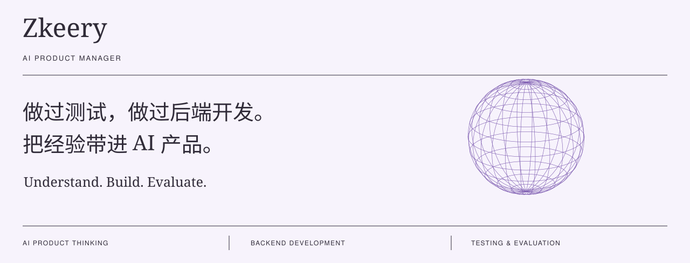

### 关于我 / About

我是 Zkeery，一名有测试与后端开发背景的 AI 产品经理。测试经历让我重视质量与效果验证，后端开发经历让我理解技术边界与实现成本。

我关注真实场景中的 AI 应用：什么问题值得解决，AI 适合做到哪一步，以及怎样衡量效果。与技术团队一起，在用户体验、成本和质量之间做取舍，推动产品落地与迭代。

---

### 代表作品 / Products

| 产品 | 解决什么问题 | 我做的关键判断 |
| --- | --- | --- |
| [AI造梦机](https://github.com/Zkeery/ai-dream-machine) | 短视频、漫剧创作者改一个镜头，整部片子跟着返工 | 把一部作品当整体管：拆成剧本、角色、分镜、画面、成片几个阶段，每步确认再往下走，哪里不对只重做哪里 |
| [Agent造物坊](https://github.com/Zkeery/agent-factory) | 有产品点子，但没法快速做出能试用的东西 | 先用对话把需求问清楚、定好验收场景，再让开发与验证两个 Agent 分工构建，人只做关键决策和最终试用 |
| [AI办公搭子](https://github.com/Zkeery/AI-office-partner) | 周报、复盘、调研简报，大量时间花在整理材料上 | 单 Agent 先出计划、程序按步骤执行；结果可改章节、可恢复版本、可定时重复跑 |
| [AI万物伙伴](https://github.com/Zkeery/ai-wanwu-companion) | 陪伴类产品聊几天就腻，记不住你 | 从一张日常物品照片生成伙伴，用可管理的记忆和生活场景，让陪伴慢慢长出来 |

---

### 最近在写 / Notes & Thoughts

2026-09-14 · AI 思考 
[Dario 呼吁放慢 AI，我们还能控制它的速度吗？ ↗](https://mp.weixin.qq.com/s/jsSOinJHopV7sqV3xnCQzQ)

2026-08-30 · 技术观察 
[Anthropic 又搞了个标准，押不押先看这四条 ↗](https://mp.weixin.qq.com/s/1tvOVshXlER1XdlE4X0deg)

2026-08-30 · 内容观察 
[《皇帝吃泡面，大佬交房租，AI漫剧到底靠什么爆》 ↗](https://mp.weixin.qq.com/s/U3Mj3RT9FhxRX1neVbxPDQ)

---

[个人网站 ↗](https://zkeery.github.io/) &nbsp; / &nbsp; [小红书 ↗](https://www.xiaohongshu.com/user/profile/5a6c65b4e8ac2b323a5b7c45) &nbsp; / &nbsp; [给我写邮件 ↗](mailto:a18381518798@gmail.com)
